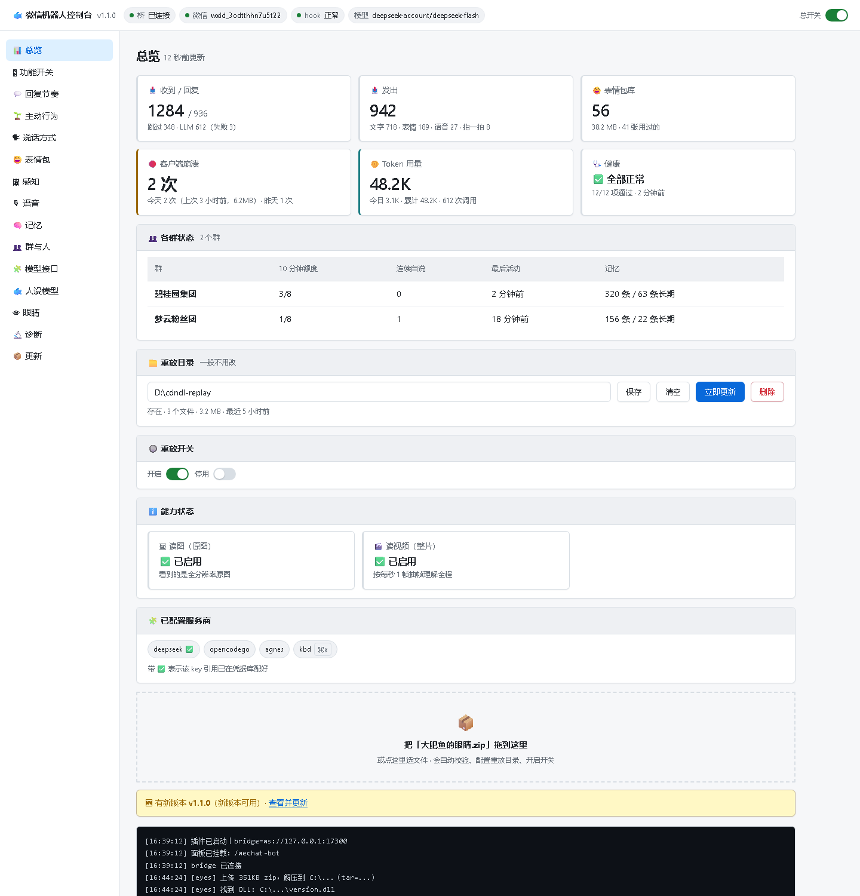

# 微信机器人

把微信变成一个**有性格、有记忆、会发表情包、看得懂图/视频/语音**的群聊机器人。带一个 **Web 控制面板**，也提供 **MCP / WebSocket / HTTP** 三种接口给任意 AI agent 驱动。

[](https://nodejs.org)
[](https://www.python.org)
[]()
[](LICENSE)

> ⚠️ **动手改部署前请先读 [docs/OPERATIONS-RULES.md](docs/OPERATIONS-RULES.md)**
> —— 记着「为什么不能强杀微信 / 为什么不能自动拉起客户端 / 为什么看门狗只做进程内自愈」，每条都是真实事故换来的。
> 重启客户端请用 [scripts/safe-restart-client.ps1](scripts/safe-restart-client.ps1)（会先备份、正常退出、等加载）。

---

## ⚠️ 二次开发声明（请务必先读）

**本项目是「二次开发」产物，不是从零原创。**

| 组成 | 来源 | 我们的工作 |
|---|---|---|
| **微信 Hook（`version.dll`）** | [aixed/WeChat-Hook](https://github.com/aixed/WeChat-Hook)（**无 LICENSE**）| 改了 C++ 源码并自行编译（5 处：QueryDB 门禁/自愈/JSON 加固/懒加载重扫 + 调试路由）。**源码版权归原作者**；本仓库**只给补丁、不给二进制** |
| **微信客户端** | 腾讯 | 仅本地调用，**不修改、不分发** |
| 接入层 / 拟人策略 / MCP / REST / 控制面板 / 图片解密 | 本项目原创 | 全部自研 |
| 图片解密格式（V2）| 社区公开资料 | 适配与工程化，非从零逆向 |

**因此**：

1. 使用前需你**自行获取**微信 Hook 项目（并遵守其许可），本项目只给补丁与说明。
2. **请自行评估合规风险**：修改/挂钩微信客户端可能违反腾讯用户协议，账号存在被封禁的可能。**请仅用于个人学习研究，不要用于商业用途或骚扰他人。**
3. 本项目**不含任何微信账号、密钥、聊天数据**。表情包现场生成需要你自己接一个图像服务的 key（环境变量或本地凭据，仓库里只有占位符）——**不配也能用**，会退化为"只用现成图库"。

---

## 它能做什么

| 能力 | 说明 |
|---|---|
| **拟人聊天** | 不是"有问必答"：闲聊按概率插话、被 @ 必回、打字延迟、偶尔拆成两条、深夜睡觉 |
| **作息** | 23:00 睡 / 08:00 醒（可配）。睡觉时**不主动插话，但被 @ 仍会回** |
| **长期记忆** | 本地 JSON；自动提炼"谁是谁 / 谁喜欢什么 / 约定 / 事件"；**每群独立** |
| **认识群里的人** | 从微信数据库读**真实昵称**（备注优先），会 @ 对人；能认出"哪个是自己" |
| **表情包** | 收藏群里的表情（存本体、去重）→ 视觉模型**自动打标签** → 聊到相应语境**按标签挑出来发**；也能图生图现场生成（文字气泡本地绘制，保证字清楚）|
| **识图** | 群里的图片**自动解密** → 视觉模型识别 → 参与聊天；识别完删临时文件 |
| **视频识别** | 每秒 1 帧 → 每 20 帧一张带时间戳的**联系表** + 抽音轨走本地语音识别 → 参与聊天。详见 [docs/视频识别.md](docs/视频识别.md) |
| **语音识别** | 群里的语音自动转文字（本地 SenseVoice，**不需要 API key**）。详见 [docs/语音识别.md](docs/语音识别.md) |
| **语音气泡** | 机器人能发**真正的微信语音**（type 34，可点播）。详见 [docs/语音气泡.md](docs/语音气泡.md) |
| **抖音刷** | 自己去刷推荐流 → 看画面+听台词 → 按自己口味挑一条发群；**纯只读**。详见 [docs/抖音自动刷.md](docs/抖音自动刷.md) |
| **生图** | 表情包/配图现场生成（Agnes 云端 / 本地 ComfyUI 可选）。详见 [docs/生图.md](docs/生图.md) |
| **真 @ 提醒** | 正文写 `@群昵称` + 把 wxid 传进 `atlist` → 对方**真的收到红点** |
| **一键自检** | `wechat_bot_selfcheck`：桥/登录/hook/数据库/轮询/自己是谁/群昵称/语音/识图/表情包/记忆/LLM 路由 **12 项只读体检** |
| **失联监控** | 心跳检查，异常时通过文件传输助手告警（静默 30 分钟防刷屏）|
| **多 agent 接入** | MCP Server（Claude Desktop / Cursor / Cline）+ REST API + WebSocket + 托管模式 |

---

## 🎛 控制面板

浏览器里管这个机器人，**不用改配置文件**。



**怎么打开**

```bash
# 1) 启动 DSH（面板挂在它的 webServer 上）
npx @deepseek-ai/dsh web --port 3080

# 2) 浏览器打开（先登录 DSH，面板复用它的登录态）
http://127.0.0.1:3080/wechat-bot
```

> 面板和 DSH 插件是同一个包 —— 没有 DSH 就没有面板。
> 想让**局域网/手机**访问：`dsh web --port 3080 --host <你的内网IP> --trusted-host <你的内网IP>:3080`
> （DSH 的 `--host` 不接受 `0.0.0.0`，必须填具体 IP；**不要暴露公网**）

**14 个页面**

| 页面 | 内容 |
|---|---|
| 📊 **总览** | 收发统计、表情包库、崩溃次数、token 用量、健康自检、各群额度、最近消息 |
| 🎛 **功能开关** | 各功能总闸、演练模式 |
| 💬 **回复节奏** | 回复概率、冷却、10 分钟上限、连发保护 |
| 🌱 **主动行为** | 主动发言概率/间隔/安静时段 |
| 🗣 **说话方式** | 温度、长度、拆条、语气 |
| 😄 **表情包** | 生成、挑选、发送、图库浏览 |
| 🖼 **感知** | 视觉开关、链接视频、抖音 |
| 🎙 **语音** | 音色、开关、概率 |
| 🧠 **记忆** | 增删查、提炼 |
| 👥 **群与人** | 成员、wxid→昵称映射 |
| 🧩 **模型接口** | provider 增删、连通性测试、生图接口 |
| 🐟 **人设模型** | 人设参数 |
| 👁 **眼睛** | **拖入 zip 一键装**原图/视频整片能力（见下）|
| 🔬 **诊断** | 崩溃 dump / 数据库 / API 表 / 眼睛目录 / 磁盘 / LLM 路由 |
| 📦 **更新** | 按版本号检查更新、一键更新（先备份、失败回滚）|

**眼睛**：拖入「大肥鱼的眼睛.zip」→ 自动解压、校验 DLL 能力（CDN 重放 / 视频整片）、备份旧 DLL、安装、自动配置重放目录和开关。
装之前两个能力显示「未启用」，装完变「已启用」。
**前提**：DLL 必须含 CDN 重放 —— 本项目不分发这个 DLL，面板会明确显示这一项。

---

## 快速开始

### 方式一：一键部署（推荐）

```powershell
# 在仓库根目录运行。依次完成：环境检查 → 装依赖 → 准备独立微信
# → 编译 Hook（调 scripts/build-hook.ps1）→ 部署 DLL → 写配置 → 启动 → 健康检查
pwsh -ExecutionPolicy Bypass -File .\一键部署.ps1
```

### 控制面板

面板挂在 DSH 的 webServer 上，复用 DSH 登录态：

```powershell
npx @deepseek-ai/dsh web --port 3080
# → http://127.0.0.1:3080/wechat-bot
```

> **端口不用猜，从地址栏看。**
>
> `dsh web` 启动后会自动打开浏览器，那个页面的地址栏就是你的 DSH 地址
> （`http://127.0.0.1:3080/`，或你换过的任何端口）。在末尾加 `/wechat-bot` 回车：
>
> ```
> http://127.0.0.1:3080/            ← DSH 首页（启动后自动打开的）
> http://127.0.0.1:3080/wechat-bot  ← 控制面板
> ```
>
> 换了端口（比如 8080）就是 `http://127.0.0.1:8080/wechat-bot`。
> **打开面板后，左上角会显示它自己的完整地址，点一下就能复制**，方便发给别人。

**桥连上微信时自动打开面板**

微信登录成功（桥连上）后，插件会用系统默认浏览器自动打开面板 —— 不用每次自己找地址。

```
地址从哪来（按优先级）：
  ① 配置项 panelUrl        ← 一键部署会按 -DshPort 自动写好
  ② 配置项 panelHost
  ③ 面板自己学到的 host    ← 你打开过一次面板，它就把 Host 头记住了
  ④ http://127.0.0.1:3080/wechat-bot（兜底）
```

**一键部署会自动写 `panelUrl`**：`-DshPort` 给多少就写多少（默认 3080）。

不想弹的话，面板「🔧 高级/接入」页把 **「桥连上时自动打开面板」** 关掉即可。

**它覆盖的功能**：

| 能做的事 |
|---|
| 看群 / 消息 / 表情包 / 语音；发消息 / 表情 / 拍一拍 / 语音 |
| 改 101 项配置（人设、概率、模型…）|
| 记忆增删查、提炼长期记忆、成员名字 |
| 拖入 zip 装眼睛（预检 + 备份 + 安装 + 配重放）、眼睛状态/开关/清理 |
| 自检 7 项、诊断（崩溃 / 数据库 / 磁盘）|
| 用量统计、一键更新 |
| 模型接口管理（provider / key / 连通性测试）|

**可选参数**

```powershell
# 已有 version.dll，跳过编译（最快）
pwsh -ExecutionPolicy Bypass -File .\一键部署.ps1 -HookDll "D:\my-version.dll"

# 只装代码和依赖，不碰微信、不启动
pwsh -ExecutionPolicy Bypass -File .\一键部署.ps1 -SkipHook -NoStart

# DSH 不是跑在 3080 上？把这个端口告诉部署脚本
pwsh -ExecutionPolicy Bypass -File .\一键部署.ps1 -DshPort 8080

# 指定微信目录（不给就自动找）
pwsh -ExecutionPolicy Bypass -File .\一键部署.ps1 -WeChatDir "D:\wxhook\wx4110"
```

**关于耗时**（最常问的）

| 情况 | 耗时 |
|---|---|
| 机器上已有 VS 2022 / MSBuild | **整套约 1~2 分钟**（编译本身 1.2 秒）|
| 机器上没有编译器 | **首次多花 15~30 分钟**（自动装 VS Build Tools，2~6 GB，脚本会先问你）|
| 之后微信升级要重编 | 还是 **1.2 秒** |

> 脚本优先用 `pwsh`（PowerShell 7，原生 UTF-8）；只有 5.1 时回退，脚本自带 BOM 不会乱码。

### 方式二：手动（照 DEPLOY.md 做）

```powershell
# 1) 前置：Node 18+、Python 3.10+（含 pycryptodome）
# 2) 克隆
git clone <本仓库地址> wechat-bot
cd wechat-bot

# 3) 一键安装（装依赖 + 生成配置模板 + 检查环境）
powershell -ExecutionPolicy Bypass -File .\install.ps1

# 4) 填配置（微信路径、Python 路径、可选 LLM key）
notepad .\config.json

# 5) 起桥
cd wx-bridge
npm start

# 6) （可选）起 DSH + 控制面板
npx @deepseek-ai/dsh web --port 3080
#    → http://127.0.0.1:3080/wechat-bot
```

**完整部署步骤（含微信 Hook 编译、回调/轮询、排错）见 [DEPLOY.md](DEPLOY.md)。**

> ⚠️ **关于预编译 Hook（version.dll）**
> 本仓库**不分发**编译好的 `version.dll` —— 上游 [aixed/WeChat-Hook](https://github.com/aixed/WeChat-Hook) 没有 LICENSE，
> 它的编译产物属于衍生作品，再分发有法律风险。所以改成**脚本在你本机编译**：
> 克隆上游源码 → 打本仓库的补丁 → 编译 → 部署（自动备份原文件）。效果一样，但更干净。
>
> **注意**：直接下载官方 release 的 `version.dll` **不能用** —— 官方版的 `QueryDB` 是坏的，且没有回调推送实现，
> 会导致读不到数据库、收不到消息。必须走「源码 + 补丁 + 编译」这条路。

> 🤖 **想让 AI 替你装？** 把 **[docs/AI-一键部署.md](docs/AI-一键部署.md)** 第 2 节整段复制给任意 AI 客户端
> （豆包 / Claude Desktop / Cursor / Cline / DSH…），它会自己完成环境检查 → 装依赖 → 复制独立微信 →
> 编译 Hook → 改配置 → 启动 → 逐项验证。你只需提供**微信安装目录**和**一个可以牺牲的微信号**。

---

## 架构

```
微信客户端（含改造版 version.dll）
        │  HTTP 30001 + 回调
        ▼
   wx-bridge（独立 Node 服务）
        ├── 数据库轮询收消息 / 图片解密 / 语音解码 / 视频抽帧
        ├── 表情包库 / 生图 / 气泡绘制
        ├── REST API  ← 控制面板 / 脚本 / 任意 agent
        └── MCP Server ← Claude Desktop / Cursor / Cline …
        │  WebSocket
        ▼
   大脑（二选一）
        ├── DSH 插件 wechat-group-agent（人设 + LLM + 记忆 + 识别 + 自检）
        └── 外部 agent（经托管模式）
```

**重要**：`DSH 插件` 与 `托管模式` 是**两个大脑**，同时开会导致**每条消息回复两次**。用哪个开哪个（桥会打印警告）。

---

## 目录结构

```
wechat-bot/
├── wx-bridge/            接入层（Node 服务）: 收消息/解密/媒体/表情包/REST/MCP
├── wechat-group-agent/   大脑（DSH 插件）
│   ├── lib/              人设、策略、LLM、记忆
│   └── panel/            ★ Web 控制面板（单文件 HTML）
├── scripts/              运维脚本（安全重启、备份等）
├── docs/                 所有详细文档
│   ├── images/           截图
│   └── *.md              语音/视频/气泡/抖音/生图/角色设定/运维规则/…
├── install.ps1           一键安装
├── config.example.json   配置模板
└── DEPLOY.md             完整部署指南
```

---

## ⚠️ 路径要求（踩过坑）

**微信数据目录（`xwechat_files` 所在路径）不要含中文。**

```
✅ D:\WeChatData\                              纯 ASCII，安全
✅ C:\Users\alice\Documents\xwechat_files      用户名是英文，安全
❌ C:\Users\张三\Documents\xwechat_files        用户名是中文 → 路径带中文
❌ D:\微信数据\
```

早期版本的库名提取函数只放行 ASCII（`if (c < 0x20 || c > 0x7E) return false`），
UTF-8 中文字符每个字节都 `> 0x7E` → 整个函数失败 → 库名取不到 → 只能扫描猜名字 → 按名查找全 miss：

```
GetAllDBName 能列库，但 QueryDB/execute 一律返回
  {"status":-1,"desc":"get database handle which named message_0.db failed"}
```

已修（2026-10-22），但**仍然建议**数据目录放纯 ASCII 路径 —— hook/SQLite/备份脚本对非 ASCII 的支持各不相同。
查看当前目录：**微信 → 设置 → 文件管理 → 文件保存位置**。
详见 [docs/DB-句柄修复说明.md](docs/DB-句柄修复说明.md)。

---

## 安全提示

**Hook 的 HTTP 接口默认只监听 `127.0.0.1`**（不是 `0.0.0.0`）。

这些接口**没有任何鉴权**：`/SendTextMsg` 能以你的账号发消息，`/QueryDB/execute` 能执行任意 SQL 读写微信数据库。
如果监听在 `0.0.0.0`，**同一局域网内任何人都能直接控制你的微信账号**。

接入层（wx-bridge）在同一台机器上，用回环地址就够了；确需远程访问请自建反向代理 + 鉴权。
**控制面板同理** —— 它能控制微信账号，DSH 的 `--trusted-host` 只是浏览器信任栅栏，不是身份认证，**不要暴露公网**。

---

## 📚 详细文档

| 文档 | 内容 |
|---|---|
| [DEPLOY.md](DEPLOY.md) | 完整部署（Hook 编译、回调/轮询、排错）|
| [docs/OPERATIONS-RULES.md](docs/OPERATIONS-RULES.md) | **运维红线 R1–R16**（每条都是事故换来的）|
| [docs/AI-一键部署.md](docs/AI-一键部署.md) | 给 AI 客户端的部署指引（可整段喂给 AI）|
| [docs/DB-句柄修复说明.md](docs/DB-句柄修复说明.md) | 数据库句柄问题的根因与修复（含中文路径坑）|
| [docs/语音识别.md](docs/语音识别.md) | 语音消息 → 文字 |
| [docs/视频识别.md](docs/视频识别.md) | 视频抽帧 + 音轨 → 理解画面和台词 |
| [docs/语音气泡.md](docs/语音气泡.md) | 让机器人发出真正的微信语音 |
| [docs/抖音自动刷.md](docs/抖音自动刷.md) | 自己去刷推荐流、挑一条发群 |
| [docs/生图.md](docs/生图.md) | 表情包/配图生成（云端或本地 ComfyUI）|
| [docs/大肥鱼角色设定.md](docs/大肥鱼角色设定.md) | 示例人设 |
| [docs/hook改造说明.md](docs/hook改造说明.md) | Hook 改造技术说明 |
| [patches/](patches/) | Hook 源码补丁（RVA 已打码）|

---

## 已知限制（诚实说明）

| 限制 | 说明 |
|---|---|
| **视频原片** | 视频整片依赖 Hook 的 CDN 重放（本项目不分发）；没有时退化为明文封面，再不行就 `[视频]` |
| **图片原图** | 同上。没有原图时用解密出的缩略图识别 |
| **微信版本** | 只适配 **4.1.10.27 x64**；升级后偏移会失效 |
| **数据库句柄** | 少数环境下 `db_filename` 取不到库名（见 [DB 文档](docs/DB-句柄修复说明.md)）；可用纯 ASCII 数据目录避开 |
| **预编译 Hook** | 不提供，需要自己编译（见上文）|
| **多开** | 需要复制独立微信目录 + 独立 Hook，不要和主微信共用 |

---

## ⭐ 如果你是"被叫来部署这个项目"的 AI

1. **先读** [docs/OPERATIONS-RULES.md](docs/OPERATIONS-RULES.md) —— 里面是不可违反的运维红线
2. **再读** [docs/AI-一键部署.md](docs/AI-一键部署.md) —— 完整的部署流程与验证清单
3. **部署前必须确认**：微信安装路径、数据目录是否为纯 ASCII、是否准备了可牺牲的小号
4. **不要**强杀微信、不要自动拉起客户端、不要改 Hook 的监听地址为 `0.0.0.0`

---

## 致谢

- [aixed/WeChat-Hook](https://github.com/aixed/WeChat-Hook) —— 微信 Hook 基础（本项目只提供补丁，不提供二进制）
- [DeepSeek Harness](https://github.com/deepseek-ai) —— 插件运行时
- SenseVoice / imageio-ffmpeg / Playwright / yt-dlp 等上游项目

## 许可

MIT（本项目原创部分）。二次开发部分的版权归各自原作者，详见文首「二次开发声明」。
